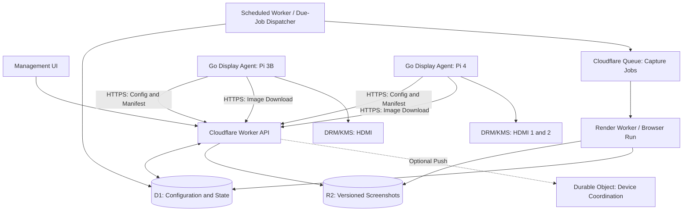

# Ribbonfish

> **Project status: concept / proposed architecture.** No production implementation is implied by this document.

## Render Once. Display Anywhere.

Ribbonfish is an aspirational, Cloudflare-native platform for centrally managing information-only screens on lightweight Linux devices.

Instead of running a browser on every Raspberry Pi, it renders websites remotely, distributes versioned screenshots, and displays them directly through Linux DRM/KMS.

The initial use case is a fleet of Raspberry Pis showing company websites and Uptime Kuma monitoring dashboards. The project is intended to meet internal operational needs while being designed, tested, and documented to the standard of a high-quality open-source project.

---

## Goals

- Run on Raspberry Pi 3B and 4 without a full desktop, Chromium, or a browser extension.
- Centrally configure sites, per-site capture schedules, playlists, devices, and physical outputs.
- Support one or multiple independent HDMI outputs per device.
- Continue displaying cached content during Cloudflare or network outages.
- Render a given site/viewport variant once and reuse its screenshot across devices.
- Be secure by default, observable, reproducible, and straightforward to maintain.
- Keep the display agent small, predictable, and independent of Cloudflare-specific implementation details.

## Non-Goals (Initially)

- Interactive websites, touchscreens, video, or audio playback.
- Sub-second monitoring or streaming live web content.
- A general-purpose desktop, browser replacement, or remote shell.
- Arbitrary remote command execution from the control plane.

---

## Architecture (Proposed)



---

## Cloud Services

| Component | Proposed Responsibility |
|------------|-------------------------|
| Workers | Management UI/API, authenticated device endpoints, configuration and image manifests |
| D1 | Sites, render variants, playlists, devices, outputs, assignments, capture status, and audit records |
| Browser Run | Headless page rendering and screenshot capture, with explicit viewport and load/wait policies |
| R2 | Versioned screenshot objects, retention, and last-known-good images |
| Queues | Asynchronous capture jobs, retries, and failure isolation |
| Scheduled Worker | Detect due captures at a practical polling cadence and enqueue deduplicated work |
| Durable Objects (optional) | Real-time device presence and low-latency commands; not required for local rotation |

Cloudflare Browser Run supports screenshot Quick Actions and browser sessions. The renderer implementation should be replaceable, and all quotas, costs, scheduling limits, and authenticated-page capabilities must be validated before production use.

---

## Device Software

A small Go agent, running as a `systemd` service on Raspberry Pi OS Lite or another compatible Linux distribution, will:

1. Identify available DRM/KMS connectors, supported modes, and output identities.
2. Authenticate to the control plane and retrieve versioned configuration.
3. Download changed screenshots with integrity checks and atomic cache replacement.
4. Decode and present images through a DRM/KMS display backend, without X11, Wayland, or Chromium.
5. Independently rotate playlists on each physical output.
6. Report bounded health telemetry and recover after reboot or disconnection.

> Direct DRM/KMS display is a technical hypothesis requiring a hardware proof of concept, particularly for Raspberry Pi 3B, Pi 4 dual-HDMI, display hotplug, image scaling, and graphics permissions.

An alternative display backend may be provided if necessary; the core agent must not depend on any specific renderer.

---

## Three Independent Clocks

### Capture Interval

How frequently Cloudflare creates a fresh screenshot of a site/variant.

### Rotation Duration

How long an image remains visible before the device advances to the next playlist item.

### Device Sync Interval

How frequently the agent checks for configuration and updated image manifests.

These are separate settings. A display can rotate between two cached screenshots every 20 seconds even when one screenshot is captured daily and another every 30 seconds.

---

## Illustrative Configuration

```yaml
sites:
  - id: future-tools-news
    url: https://futuretools.io/news
    capture_interval: 24h
    viewport:
      width: 1920
      height: 1080
    wait_strategy: network-idle-or-timeout

  - id: uptime-kuma
    url: https://status.example.com
    capture_interval: 30s
    viewport:
      width: 1920
      height: 1080
    wait_strategy: selector-or-timeout

playlists:
  - id: office-rotation
    entries:
      - site: future-tools
        display_duration: 60s

      - site: uptime-kuma
        display_duration: 60s

devices:
  - id: office-pi-4
    sync_interval: 30s

    outputs:
      - connector: HDMI-A-1
        playlist: office-rotation

      - connector: HDMI-A-2
        playlist: office-rotation
```

> This is an illustrative product schema, not an implemented configuration format.

Physical connector names and stable display identification will be validated against actual devices. A 30-second capture interval is a target, not a guarantee of precisely timed capture or delivery.

---

## Core Workflows

### 1. Provision a Device

An administrator creates a device and assigns one or more output playlists.

A one-time enrollment credential is exchanged for scoped device credentials. The agent downloads its initial configuration and cached images, then starts presenting content.

Credentials can be rotated or revoked without reimaging the device.

### 2. Schedule and Capture a Site

A scheduler checks which site/viewport variants are due, claims each due job without duplication, and submits work to a queue.

The renderer:

- Loads the page
- Applies a bounded wait policy
- Captures the requested viewport
- Validates the result

A successful image is written to R2 under an immutable versioned key. Only then is the current manifest updated.

Failed captures preserve the last-known-good image, with bounded retries, backoff, and alerts.

A screenshot variant is keyed by rendering-relevant inputs such as:

- URL
- Viewport
- Authentication context
- Capture policy

Reuse is allowed only when those inputs and access permissions are compatible.

### 3. Synchronize a Device

The agent periodically requests a signed or authenticated configuration manifest.

If the version has changed, it:

1. Downloads new images into temporary files.
2. Verifies their size and hash.
3. Atomically promotes them into the local cache.

A bounded number of previous versions are retained for recovery.

An interrupted download must never replace a valid image.

### 4. Rotate Independently per Display

Each output maintains its own:

- Playlist index
- Dwell timer
- Current image

Rotation happens locally and independently of Cloudflare.

A device with two HDMI outputs may show different playlists simultaneously.

New image versions replace relevant cached assets without resetting unrelated display timers.

### 5. Operate Offline

When connectivity is lost, the device:

- Continues using its last-known-good configuration
- Continues displaying cached images
- Exposes a configurable stale-content indicator
- Reports reconnection when connectivity returns
- Resumes synchronization without blanking the display

Missing initial content displays a local fallback image or status screen.

### 6. Manage and Observe the Fleet

The management interface should provide:

- Device inventory
- Output assignments
- Screenshot previews
- Last successful captures
- Capture errors
- Device last-seen timestamps
- Software versions

Administrators may request:

- Safe refresh
- Configuration resynchronization
- Playlist changes

All commands must be explicitly allow-listed, authenticated, and auditable.

---

## Security Principles

- No general-purpose browser, third-party rotation extension, or desktop session on display devices.
- TLS transport, per-device identities, scoped access, credential revocation, and rotation.
- Human administrator authentication and role-based authorization.
- No secrets embedded in screenshots, configuration manifests, logs, or repository history.
- Allow-listed render targets and SSRF protection against private networks, metadata endpoints, and unsafe redirects.
- Isolate credentials for private pages; do not reuse protected screenshots across unrelated access scopes.
- Do not expose R2 objects publicly by default; use authenticated delivery or narrowly scoped expiring URLs.
- Validate image dimensions, formats, sizes, and hashes before decoding on devices.
- Run the agent with minimal privileges; document DRM permissions and systemd hardening.
- Signed, reproducible releases and an explicit update/rollback strategy.

---

## Reliability and Performance

The project will measure, rather than assume, the benefits of remote rendering.

Benchmark categories include:

- Idle CPU usage
- Active CPU usage
- RAM consumption
- Boot-to-display time
- Rotation latency
- Image-download bandwidth
- Power usage
- Recovery behavior

Comparisons should be made against the existing desktop-plus-Chromium kiosk approach.

Key scenarios to test include:

- Network loss
- Cloudflare failure
- Malformed images
- Failed captures
- Low disk space
- Sudden power loss
- HDMI disconnect/reconnect
- Mixed monitor resolutions
- Dual-output operation

Capture costs must be modeled using actual browser time, capture frequency, and the number of distinct rendering variants.

For example:

- One site captured every 30 seconds requires up to **2,880 captures/day** before retries.
- One site captured daily requires **1 capture/day**.

Device count should not multiply rendering work when assets can be safely shared.

---

## Proposed Repository Layout

```text
/
├── apps/
│   ├── control-plane/      # Worker API and management UI
│   └── renderer/           # Screenshot capture integration
├── agent/                  # Go device agent and display backends
├── packages/
│   └── contracts/          # API schemas and versioned manifests
├── infrastructure/         # Cloudflare/Wrangler configuration
├── docs/                   # Architecture, security, operations, ADRs
├── tests/                  # Contract, integration, and system tests
├── examples/               # Example configuration
└── README.md
```

> This is a proposed monorepo structure. Boundaries and tooling should be adjusted following the first proof of concept.

---

## Roadmap

### Phase 0 — Feasibility

Prove direct DRM/KMS image display on:

- Raspberry Pi 3B
- Raspberry Pi 4 dual-HDMI

Measure:

- Memory consumption
- CPU consumption
- Image switching performance

### Phase 1 — Vertical Slice

- Render one public website using Browser Run.
- Store the screenshot in R2.
- Display it through a manually configured agent.

### Phase 2 — Scheduling

Add:

- D1 site configuration
- Independent per-site capture intervals
- Due-job scheduling
- Queues
- Retry policies
- Last-known-good manifests

### Phase 3 — Fleet Management

Add:

- Device enrollment
- Secure synchronization
- Playlists
- Output assignments
- Basic management UI

### Phase 4 — Operational Hardening

Add:

- Telemetry
- Audit events
- Offline recovery
- Integration tests
- Benchmark results
- Release automation

### Phase 5 — Extensions

Explore:

- Durable Object push coordination
- Alternative renderers
- Native data-to-image dashboards
- Wider Linux hardware support

---

## Engineering Standards

The intended standard is production-quality open source:

- Clear interfaces
- Typed contracts
- Small components
- Deterministic tests
- CI pipelines
- Static analysis
- Dependency and security scanning
- Documentation
- Semantic versioning
- Changelogs

Changes should include:

- Relevant tests
- Threat-model updates
- Operational notes

The repository should ultimately include:

- `CONTRIBUTING.md`
- `SECURITY.md`
- A code of conduct
- An appropriate open-source license

---

## Open Design Decisions

1. DRM/KMS library and image-decoding strategy for Go, including multi-output support.
2. Stable physical display identity across reboot and connector reordering.
3. Minimum practical capture cadence and scheduling mechanism for 30-second sites.
4. Browser Run Quick Actions versus persistent sessions for complex or authenticated pages.
5. Device authentication, enrollment, and credential rotation.
6. Image format, compression, scaling, storage retention, and delivery method.
7. Whether a shared 30-second screenshot is sufficiently fresh for operational monitoring.
