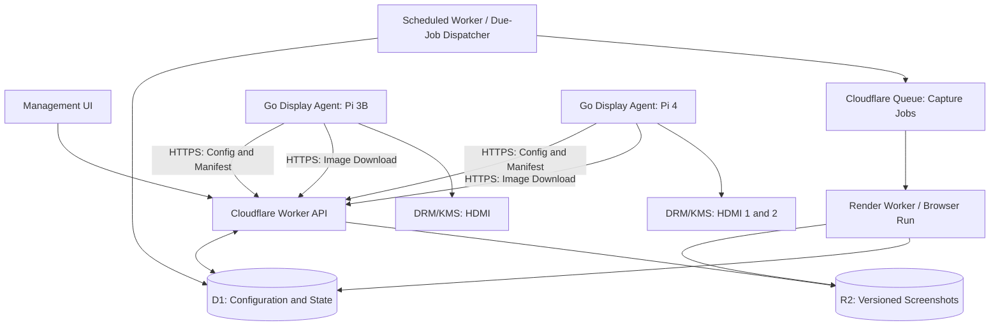

# Ribbonfish

[](https://github.com/CyanAutomation/ribbonfish/actions/workflows/agent.yml) [](https://github.com/CyanAutomation/ribbonfish/actions/workflows/device-sync.yml) [](https://github.com/CyanAutomation/ribbonfish/actions/workflows/arm-container-smoke.yml)

> **Project status:** The Go agent supports bundled offline profiles, a verified persistent image cache, optional authenticated Worker/R2 content sync, a software simulator, and an experimental Linux DRM/KMS output backend. Single-display KMS output has been accepted on a Pi 3 A+; Pi 3B and Pi 4 dual-output acceptance remain open. The broader screenshot capture and management platform is still proposed.

## Render Once. Display Anywhere.

Ribbonfish is an aspirational, Cloudflare-native platform for centrally managing information-only screens on lightweight Linux devices.

Instead of running a browser on every Raspberry Pi, it renders websites remotely, distributes versioned screenshots, and displays them directly through Linux DRM/KMS.

The initial use case is a fleet of Raspberry Pis showing company websites and Uptime Kuma monitoring dashboards. The project is intended to meet internal operational needs while being designed, tested, and documented to the standard of a high-quality open-source project.

---

## How It Works

1. The container starts from a bundled, hardware-specific default config and starter images.
2. An enrolled device can poll an authenticated Worker for a versioned content manifest and images held in R2.
3. The Go agent verifies image hashes, caches content, and rotates local playlists through the simulator or DRM/KMS output.
4. It keeps the active snapshot and continues displaying it when sync is disabled or the network is unavailable.

**Implementation status:** The agent ships Pi 3 A+, Pi 3B, Pi 4, and simulator profiles with sample images. Optional sync is implemented in the Go agent and the Worker under [`workers/device-sync`](workers/device-sync/README.md): one-time codes enroll devices, D1 stores token hashes, and the Worker uses an R2 binding to serve only a device's manifest and assigned image hashes. Candidate snapshots are validated and applied atomically; failed sync leaves the previous snapshot active. The Worker and Go client are tested locally, but a deployed Cloudflare account and end-to-end Cloudflare credentials are not part of this repository setup.

The DRM backend configures named connectors, selects advertised modes, and uses XRGB8888 dumb buffers with page flips. It is experimental: one single-display Pi 3 A+ has passed physical KMS and visible-frame acceptance, while Pi 3B and Pi 4 dual-output behavior remain open.

The agent can also list Linux DRM connector metadata from sysfs with
`ribbonfish -list-displays`. This reads sysfs only and reports whether the
corresponding device node exists; it does not verify device permissions,
acquire DRM master, or drive a display.

## Local Agent Demonstration

Run the two-display offline simulator using the instructions in
[`examples/agent/simulator/README.md`](examples/agent/simulator/README.md).
It uses local sample images and writes current frames to PNG files. Cross-
compilation for Raspberry Pi architectures does not claim hardware support.
An optional QEMU container smoke check also builds and starts the ARMv7 and
ARM64 images against simulated single- and dual-display profiles; this verifies
container compatibility only and does not replace physical Pi testing.

## Goals

- Run on Raspberry Pi 3B and 4 without a full desktop, Chromium, or a browser extension.
- Centrally configure sites, per-site capture schedules, playlists, devices, and physical outputs.
- Support one or multiple independent HDMI outputs per device.
- Continue displaying cached content during Cloudflare or network outages.
- Render a given site/viewport variant once and reuse its screenshot across devices.
- Be secure by default, observable, reproducible, and straightforward to maintain.
- Keep the display agent small, predictable, and independent of Cloudflare-specific implementation details.

## Non-Goals (Initially)

- Interactive websites, touchscreens, video, or audio playback.
- Sub-second monitoring or streaming live web content.
- A general-purpose desktop, browser replacement, or remote shell.
- Arbitrary remote command execution from the control plane.

---

## Architecture (Proposed)



---

## Scheduling Constraint

Ribbonfish deliberately supports **no screenshot capture interval shorter than 60 seconds**. A single once-per-minute Cloudflare Cron Trigger dispatches due work using D1 scheduling state and Queues. This avoids sub-minute timers, delayed-message scheduling loops, and Durable Objects. Capture intervals are configuration values, not promises of exact wall-clock execution; browser rendering and device synchronisation add further freshness latency. Reject capture intervals below `60s` at the API and configuration-validation boundaries.

**Durable Objects are explicitly out of scope**, including for device presence, push commands, and display coordination. Devices poll for configuration and manifests, and all playlist rotation is local. Reconsidering this decision requires a new, demonstrated product requirement rather than speculative extensibility.

## Cloud Services

| Component | Responsibility and implementation status |
|------------|-------------------------|
| Workers | The authenticated device sync and enrollment endpoints are implemented in `workers/device-sync`; the management UI, renderer API, and capture pipeline remain proposed |
| D1 | The sync Worker uses D1 for per-device credential hashes and one-time enrollment codes; broader capture and management state remains proposed |
| Browser Run | Headless page rendering and screenshot capture, with explicit viewport and load/wait policies |
| R2 | The sync Worker reads private manifests and content-addressed images through an R2 binding; screenshot retention and capture publication remain proposed |
| Queues | Single-consumer, single-message capture execution, bounded retries, and backlog control |
| Scheduled Worker (Cron Trigger) | Run every minute, check D1 for due variants, and enqueue deduplicated capture jobs |

Cloudflare Browser Run supports screenshot Quick Actions and browser sessions. The renderer implementation should be replaceable, and all quotas, costs, scheduling limits, and authenticated-page capabilities must be validated before production use. **Serial capture execution limits concurrency, but does not by itself ensure compliance with account-wide browser session creation rates, Quick Action request rates, or daily browser-time quotas.**

---

## Device Software

### Deployment model

The experimental deployment is **Docker Compose on Raspberry Pi OS Lite**, with no graphical desktop, Chromium, X11, or Wayland session. The container includes its default profile and starter images, so the offline Compose setup needs no host-mounted config or asset files. It maps one DRM card, persists cache, last-good manifest, and the per-device credential in a state volume, and runs non-root with a read-only root filesystem and no added capabilities. Networking defaults to `none`; set it to `bridge` only for enrollment or optional sync. GitHub Actions publishes an ARMv7/ARM64 GHCR release image for `v*` tags and a multi-architecture Docker Hub image (`amd64`, `arm64`, and `arm/v7`) after a PR merges into `main`, tagged `latest` and with the immutable merge SHA (`sha-<SHA>`). Use a SHA tag for repeatable deployments. The image must already be present on the Pi for a fully offline first start.

The Compose deployment maps only the selected DRM card and its numeric device group. The agent requests DRM master, configures the selected connector(s), and takes over scanout; the host display manager or compositor must release that card. Device access does not guarantee DRM master ownership or multi-output support. Select the bundled profile and verify the device path, group, and connector on each Pi. Avoid `privileged: true`.


A small Go agent, packaged as a multi-architecture OCI image and deployed primarily with Docker Compose on Raspberry Pi OS Lite or another compatible Linux distribution:

1. Identify available DRM/KMS connectors, supported modes, and output identities.
2. Start from a bundled profile and optionally authenticate to the sync Worker with a per-device token.
3. Poll for a complete versioned content snapshot and download changed images with SHA-256 checks.
4. Decode and present images through a DRM/KMS display backend, without X11, Wayland, or Chromium.
5. Independently rotate playlists on each physical output.
6. Keep the last-good snapshot through reboots and disconnections.

Remote manifests update playlists and rotation intervals only. Hardware output, cache paths, and DRM device mappings remain local to the Pi.

> The direct DRM/KMS code is an experimental implementation. Single-display 1920x1080 KMS state and frame updates have been verified over SSH on a Pi 3 Model A Plus, and the user confirmed the sample slides were visible. Physical proof is still required for Pi 3B scanout, simultaneous distinct frames on Pi 4 HDMI outputs, hotplug/recovery, and other kernel/display combinations.

An alternative display backend may be provided if necessary; the core agent must not depend on any specific renderer.

---

## Render Variants

A **site** identifies a source URL; a **render variant** identifies a particular screenshot contract for that site. Variants may differ in viewport dimensions, authentication context, wait policy, image format, and capture cadence. Playlists reference variants rather than assuming every site has one global screenshot. A variant may be reused across displays only when its rendering inputs and authorisation scope match.

## Three Independent Clocks

### Capture Interval

How frequently Cloudflare creates a fresh screenshot of a site/variant. **Minimum supported interval: 60 seconds.** Intervals must be at least one minute and should be expressed as whole-minute multiples; longer intervals (such as `24h`) are supported. Capture timing is best-effort, not a real-time guarantee.

### Rotation Duration

How long an image remains visible before the device advances to the next playlist item.

### Device Sync Interval

How frequently the agent checks for updated image manifests. The Go agent defaults to one minute; Compose can override this with `RIBBONFISH_SYNC_INTERVAL`.

These are separate settings. A display can rotate between two cached screenshots every 20 seconds even when one screenshot is captured daily and another every 60 seconds. The 60-second minimum applies **only to screenshot capture**, not to local playlist dwell times or device synchronisation.

---

## Illustrative Configuration

```yaml
sites:
  - id: futuretools
    url: https://futuretools.io/news
    variants:
      - id: future-tools-landscape
        capture_interval: 24h
        viewport: { width: 1920, height: 1080 }
        wait_strategy: network-idle-or-timeout

  - id: uptime-kuma
    url: https://status.example.com
    variants:
      - id: uptime-landscape
        capture_interval: 60s
        viewport: { width: 1920, height: 1080 }
        wait_strategy: selector-or-timeout

playlists:
  - id: office-rotation
    entries:
      - variant: future-tools-landscape
        display_duration: 60s

      - variant: uptime-landscape
        display_duration: 60s

devices:
  - id: office-pi-4
    sync_interval: 30s

    outputs:
      - connector: HDMI-A-1
        playlist: office-rotation

      - connector: HDMI-A-2
        playlist: office-rotation
```

> This is an illustrative product schema, not an implemented configuration format.

Physical connector names and stable display identification will be validated against actual devices. The shortest supported capture interval is `60s`; captures and delivery are best-effort and may be delayed by scheduler, queue, and rendering latency.

---

## Serial Capture and Browser Budget

**Initial architectural constraint: at most one Ribbonfish screenshot capture executes at any moment across the entire deployment.** Every scheduled, manual, and retry capture must pass through the same Cloudflare Queue; no API endpoint or Cron handler may invoke Browser Run directly.

The proposed Queue consumer configuration is illustrative Wrangler JSON (confirm the deployed runtime and supported settings):

```json
{
  "queues": {
    "consumers": [
      {
        "queue": "ribbonfish-captures",
        "max_batch_size": 1,
        "max_concurrency": 1
      }
    ]
  }
}
```

The consumer processes **one message and awaits the entire browser capture and publication flow** before acknowledging it. It must not start unawaited or parallel browser operations. A configured Queue consumer concurrency of one is the primary serialisation control; use D1-backed job leases, ownership checks, and idempotency to handle duplicate deliveries and lease expiry safely. If the platform could execute an overlapping retry or a second consumer, the application must prevent concurrent browser work rather than relying on configuration alone. Serialisation is scoped to Ribbonfish, not other workloads sharing the same Cloudflare account.

### Budget and quota controls

- Define a **configurable daily browser-time budget** and per-request timeouts; store usage estimates, observed usage where available, and budget state in D1. Configure a conservative safety margin below the applicable Cloudflare plan limits.
- Before starting a capture, check the remaining budget and applicable **Browser Sessions** creation or **Quick Actions** request rate limit. These are different Cloudflare APIs with different limits; model the chosen renderer's actual quotas. Do not assume that concurrency one bypasses either rate limit.
- When the daily budget or a provider quota is exhausted, **defer or skip** new work until the relevant budget or rate window allows it. Surface the reason and stale-image age; do not retry quota failures in a tight loop. A queue consumer should not hold messages indefinitely while waiting for the next day.
- Set a maximum pending-job age and backlog threshold. **Coalesce** due captures by render variant: allow at most one outstanding queued/running capture per variant, and do not enqueue redundant historical captures when the Cron scheduler ticks again.
- Give retries bounded attempts, exponential backoff and jitter. Distinguish transient browser failures from quota exhaustion and terminal rendering failures. Failed jobs must not block all subsequent variants indefinitely.
- Track queue depth, capture duration, time since last successful screenshot, skipped/deferred captures, remaining budget, and rate-limit responses. Keep the last valid image available subject to the separate screenshot retention policy.

**Trade-off:** with a single capture slot, requested 60-second intervals are a minimum *configuration* interval, not guaranteed freshness. If aggregate render time exceeds capacity or the daily browser budget, some captures will be late or skipped. Design for predictable degradation rather than unbounded work accumulation.

---

## Optional JEV Capture Optimiser

JEV 1.14 can be evaluated as a **low-cost, optional decision engine** to reduce unnecessary Browser Run activity, improve cache reuse and make retries more resilient. Its main input should be **compact structured operational data**, not an image on every capture. Image assessment is an optional later experiment, not a prerequisite.

The optimiser sits **after deterministic eligibility checks and before the single serial capture queue**:

`Cron + D1 due variants → hard rules/cache probes → optional JEV decision → serial Queue → Browser Run → R2 → device`

### Decision scope

- **Adaptive scheduling:** consider change history, prior capture durations, recent failures, cached-image age, available browser-time budget and queue pressure to choose whether to capture now or defer. Respect the configured freshness ceiling and never schedule captures more frequently than 60 seconds.
- **Cache reuse:** prefer inexpensive deterministic checks first, such as trusted `ETag`/`Last-Modified` validators or a suitable lightweight source probe. A static HTML response or cached screenshot **cannot prove** a dynamic dashboard is unchanged; do not infer freshness from it.
- **Failure recovery:** classify bounded next actions such as `retry`, `defer`, `use_cache` or `escalate`, using error category, recent failures, cache age and quota state.
- **Queue prioritisation:** rank eligible variants when serial capture capacity or browser budget is scarce, without starving other sites or violating hard freshness requirements.
- **Optional image-aware decisions:** explore JEV image input for visual-change or cache-suitability assessment only when a screenshot already exists or the expected savings justify an additional analysis. Do not use image analysis to imply that an unobserved live site has not changed.

### Hard constraints and safe fallback

- **The configured interval is a freshness requirement by default**, not permission to defer indefinitely. Adaptive scheduling is explicitly opt-in per variant, with a user-defined maximum screenshot age and a bounded forced-refresh policy. If a site must refresh every minute, JEV cannot skip that capture merely to save money; budget exhaustion may still make the requirement unattainable and must be reported.
- Deterministic validation and provider quotas **always override** JEV. JEV must not bypass the global one-at-a-time queue, 60-second minimum, retention limits, authorisation boundaries or the daily browser-time budget.
- Validate JEV outputs against a small typed decision schema; reject invalid, stale, low-confidence or timed-out recommendations. Keep strict limits on JEV request frequency, token usage, latency and total spend so optimisation does not cost more than it saves.
- **Fail open to deterministic scheduling**, subject to hard quota and safety limits, when JEV is unavailable. A JEV outage must not stop device playback or prevent otherwise permitted captures.
- Do not send authenticated/private screenshot pixels or sensitive dashboard content to JEV without explicit opt-in and appropriate data-handling controls. Prefer metadata-only decisions.

### Delivery approach (no shadow-mode phase)

1. **Deterministic foundation:** implement budget enforcement, queue coalescing, reliable freshness timestamps, trusted conditional HTTP probes where applicable, backoff and observability.
2. **Direct, guarded JEV integration:** enable opt-in adaptive decisions immediately behind typed validation, strict timeouts, hard-rule overrides and a feature flag/kill switch. Roll out to a small set of non-critical variants with conservative deferral limits; do not introduce a separate shadow-mode stage.
3. **Measure and refine:** compare browser seconds per 1,000 capture opportunities, actual screenshot age, freshness breaches, retries avoided, queue wait, JEV latency and total combined Cloudflare/JEV cost. Disable JEV if the net benefit is negative.
4. **Optional image experiment:** assess whether JEV 1.14 image inputs improve decisions enough to justify their latency, cost and experimental reliability characteristics.

---

## Core Workflows

### 1. Provision a Device

An administrator creates a device and assigns one or more output playlists.

A one-time enrollment credential is exchanged for scoped device credentials. The agent downloads its initial configuration and cached images, then starts presenting content.

Credentials can be rotated or revoked without reimaging the device.

### 2. Schedule and Capture a Site

A Cloudflare Cron Trigger runs once per minute (`* * * * *`). Its Worker queries D1 for due render variants, atomically claims eligible jobs, and submits them to a Queue. The dispatcher uses stored `next_due_at` timestamps rather than one Cron Trigger per site. It checks the capture budget, coalesces already queued/running variants, and defers jobs it cannot afford or process promptly. Queue delivery can be at least once, so consumers must be idempotent and enforce per-variant concurrency limits. Missed ticks are reconciled on subsequent runs; overdue jobs must not create unbounded backlogs. Define bounded retries, capture timeouts, and tolerable timing drift. **No sub-minute scheduler or Durable Objects are required.**

The renderer:

- Loads the page
- Applies a bounded wait policy
- Captures the requested viewport
- Validates the result

A successful image is written to R2 under an immutable versioned key. Only then is the current manifest updated. Retention cleanup then enforces the per-variant **10 captures / 30 days, whichever is sooner** policy without deleting the newly referenced image.

Failed captures preserve the last-known-good image, with bounded retries, backoff, and alerts.

A screenshot variant is keyed by rendering-relevant inputs such as:

- URL
- Viewport
- Authentication context
- Capture policy

Reuse is allowed only when those inputs and access permissions are compatible.

### 3. Synchronize a Device

The agent periodically requests a signed or authenticated configuration manifest.

If the version has changed, it:

1. Downloads new images into temporary files.
2. Verifies their size and hash.
3. Atomically promotes them into the local cache.

A bounded number of previous versions are retained for recovery.

An interrupted download must never replace a valid image.

### 4. Rotate Independently per Display

Each output maintains its own:

- Playlist index
- Dwell timer
- Current image

Rotation happens locally and independently of Cloudflare.

A device with two HDMI outputs may show different playlists simultaneously.

New image versions replace relevant cached assets without resetting unrelated display timers.

### 5. Operate Offline

When connectivity is lost, the device:

- Continues using its last-known-good configuration
- Continues displaying cached images
- Exposes a configurable stale-content indicator
- Reports reconnection when connectivity returns
- Resumes synchronization without blanking the display

Missing initial content displays a local fallback image or status screen.

### 6. Manage and Observe the Fleet

The management interface should provide:

- Device inventory
- Output assignments
- Screenshot previews
- Last successful captures
- Capture errors
- Device last-seen timestamps
- Software versions

Administrators may request:

- Safe refresh
- Configuration resynchronization
- Playlist changes

All commands must be explicitly allow-listed, authenticated, and auditable.

---

## Security Principles

- No general-purpose browser, third-party rotation extension, or desktop session on display devices.
- TLS transport, per-device identities, scoped access, credential revocation, and rotation.
- Human administrator authentication and role-based authorization.
- No secrets embedded in screenshots, configuration manifests, logs, or repository history.
- Allow-listed render targets and SSRF protection against private networks, metadata endpoints, and unsafe redirects.
- Isolate credentials for private pages; do not reuse protected screenshots across unrelated access scopes.
- Do not expose R2 objects publicly by default; use authenticated delivery or narrowly scoped expiring URLs.
- Validate image dimensions, formats, sizes, and hashes before decoding on devices.
- Run the agent with minimal privileges; document DRM permissions, container device mapping, and container hardening.
- Signed, reproducible release artifacts with releases and version tags managed manually through the GitHub UI, plus an explicit update/rollback strategy.
- Distinct administrator authentication, one-time device enrolment, device-scoped identity and image authorisation.
- Prevent replayed remote commands and unapproved software updates; never grant a device access to another device's protected assets.

---

## Screenshot Retention Policy

Ribbonfish retains **at most the 10 most recent successful screenshots per render variant, and never retains a screenshot older than 30 days — whichever limit is reached first**. The limits apply independently to each render variant, not globally across all sites or devices. Both limits are mandatory, including for private dashboards.

- On successful capture, write a new immutable screenshot to R2, update its D1 metadata and the current manifest, then prune excess captures so no more than 10 remain for that variant.
- A scheduled cleanup pass deletes captures older than 30 days even if fewer than 10 exist, and reconciles orphaned R2 objects or D1 records after interrupted writes/deletions.
- Treat retention as a **hard upper bound**, not a promise that 10 captures or a full 30 days of history will always be available. At a 60-second capture interval, the 10-capture limit represents roughly the latest 10 minutes; at a daily interval, it represents up to 10 days.
- Avoid deleting an object while it is still referenced by a current manifest. Update pointers atomically where feasible, then delete superseded objects; retry failed cleanup safely.
- Once the latest screenshot ages beyond 30 days without a successful replacement, it must be removed from cloud retention and no longer advertised as current. Device-local cached images have a separate offline-availability policy, which must not be misrepresented as cloud retention.
- Do not retain duplicate copies, thumbnails, backups, or other screenshot-derived assets beyond these limits unless a separately documented retention policy explicitly covers them. Keep D1 metadata, audit records and logs free of image content.

Implement retention enforcement in the capture workflow and periodic reconciliation; do not rely solely on R2 lifecycle rules to enforce the 10-capture count. Validate deletion behaviour and storage consumption with automated tests.

---

## Reliability and Performance

Key scenarios to test include:

- Network loss
- Cloudflare failure
- Malformed images
- Failed captures
- Low disk space
- Sudden power loss
- HDMI disconnect/reconnect
- Mixed monitor resolutions
- Dual-output operation

Capture costs must be modelled using actual browser time, capture frequency, the number of distinct rendering variants, and the account's current plan limits. **One-at-a-time capture execution controls concurrency, not total daily browser usage.**

For example:

- One site captured every 60 seconds requires up to **1,440 captures/day** before retries.
- One site captured daily requires **1 capture/day**.

Device count should not multiply rendering work when assets can be safely shared. For illustration, capturing one variant every minute requires 1,440 captures/day; even 1 second of browser usage per capture would consume 24 browser-minutes/day. Validate the active plan's current daily allowance and price model before claiming Free-plan compatibility.

---

## Proposed Repository Layout

```text
/
├── apps/
│   ├── control-plane/      # Worker API and management UI
│   └── renderer/           # Screenshot capture integration
├── agent/                  # Go device agent and display backends
├── packages/
│   └── contracts/          # API schemas and versioned manifests
├── infrastructure/         # Cloudflare/Wrangler configuration
├── docs/                   # Architecture, security, operations, ADRs
├── tests/                  # Contract, integration, and system tests
├── examples/               # Example configuration
└── README.md
```

> This is a proposed monorepo structure. Boundaries and tooling should be adjusted following the first proof of concept.

---

## Hardware Acceptance Criteria

Phase 0 must demonstrate a container displaying a local PNG via DRM/KMS on Pi 3B, and different images on both Pi 4 HDMI outputs. Test least-privilege graphics access, scaling/aspect ratio, rotation, hotplug, monitor sleep/wake, power loss, restart and offline caching. Record CPU, RAM, image-switch latency and stability before setting numerical performance targets. Smooth, tear-free transitions are a goal subject to hardware validation.

## Roadmap

### Phase 0 — Feasibility

Prove direct DRM/KMS image display on:

- Raspberry Pi 3B
- Raspberry Pi 4 dual-HDMI

Measure:

- Memory consumption
- CPU consumption
- Image switching performance

### Phase 1 — Vertical Slice

- Render one public website using Browser Run.
- Store the screenshot in R2.
- Display it through a manually configured agent.

### Phase 2 — Scheduling

Add:

- D1 site configuration
- Independent per-site capture intervals
- One-minute Cron Trigger and D1-backed due-job scheduling
- Validation rejecting capture intervals below 60 seconds
- Queues configured for one-message batches and a single concurrent capture consumer
- Global serialisation of scheduled, manual and retried captures
- Daily browser-time budget and renderer-specific rate limiting
- Optional JEV-based capture optimisation with deterministic guardrails and opt-in adaptive freshness
- Per-variant backlog coalescing and quota-aware defer/skip behaviour
- Retry policies
- Last-known-good manifests
- Per-variant screenshot retention (10 captures or 30 days, whichever is sooner), plus cleanup and reconciliation

### Phase 3 — Fleet Management

The device-side fleet slice is implemented: one-time enrollment, per-device
credentials, authenticated manifest and asset delivery, local playlists, and
output assignments. Remaining fleet-management work includes:

- Basic management UI
- Device registry and assignment management
- Credential rotation and operator audit events

### Phase 4 — Operational Hardening

Add:

- Telemetry
- Audit events
- Offline recovery
- Integration tests
- Benchmark results
- Documented manual GitHub release and tag procedures

### Phase 5 — Extensions

Explore:

- Alternative renderers
- Native data-to-image dashboards
- Wider Linux hardware support

---

## Engineering Standards

The intended standard is production-quality open source:

- Clear interfaces
- Typed contracts
- Small components
- Deterministic tests
- CI pipelines
- Static analysis
- Dependency and security scanning
- Documentation
- Semantic versioning
- Changelogs

Changes should include:

- Relevant tests
- Threat-model updates
- Operational notes

The repository should ultimately include:

- `CONTRIBUTING.md`
- `SECURITY.md`
- A code of conduct
- An appropriate open-source license

---

## Open Design Decisions

1. DRM/KMS library and image-decoding strategy for Go, including multi-output support.
2. Stable physical display identity across reboot and connector reordering.
3. Cron-based due-job claim strategy, handling of missed minutes, and acceptable capture timing drift.
4. Browser Run Quick Actions versus persistent sessions for complex or authenticated pages.
5. Device authentication, enrollment, and per-device asset delivery are
   implemented in the sync Worker; credential rotation remains open.
6. Image format, compression, scaling, storage retention, and delivery method.
7. Whether a shared 60-second screenshot is sufficiently fresh for operational monitoring.
8. Container permissions and DRM master ownership on Pi 3B and Pi 4.
9. Capture concurrency limits, missed-job reconciliation, and capture cost ceilings.
10. Administrator authentication; device-scoped asset delivery is implemented
    in the sync Worker.
