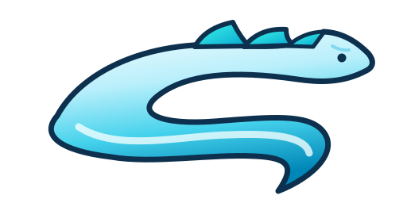
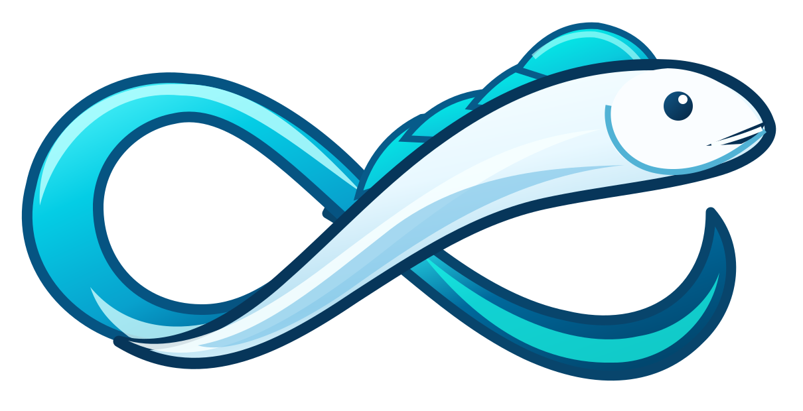
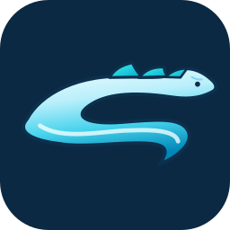

# Ribbonfish brand assets

Ribbonfish uses two coordinated but distinct **original vector marks**. The formal identity is a ribbonfish whose silver-to-cyan body sweeps into an S; the secondary loading mascot is a fish flowing around a continuous infinity loop. Both are rebuilt as editable SVG shapes with gradients, **not PNGs embedded inside SVGs**.

## Official identity: Ribbon S

Use the **Ribbon S** in the management UI, docs, headers and product branding. Its recognisable features are the long silvery head, four aqua dorsal fins, deep navy outlines, expressive eye, dark gill contour and the curled cyan tail. The reusable management header lockup pairs the mark with title-case Ribbonfish lettering and a cyan accent; keep that lockup together when adapting the header for another surface.

## Secondary mascot: Infinity Ribbon

Use the **Infinity Ribbon** as loading and capture art, not as the default product logo. It has its own vector silhouette and is animated gently by the management UI's CSS. The animation stops under `prefers-reduced-motion: reduce`. The asset can be displayed statically elsewhere.

## Favicon

The favicon is a separately simplified vector, designed for 16–64 px tab sizes. It preserves the S motif, navy rounded-square background, eye and cyan fins without requiring details that are illegible at small sizes. `favicon.png` is a matching 64×64 PNG fallback. The web app manifest and 180, 192 and 512 px PNG exports reuse this icon for home-screen and installed-app contexts.

## Source assets and usage

| Asset | Usage |
| --- | --- |
| `workers/device-sync/public/admin/ribbonfish-mark.svg` | Official standalone logo / management header |
| `workers/device-sync/public/admin/ribbonfish-loading.svg` | Loading and capture mascot / CSS animation |
| `workers/device-sync/public/admin/favicon.svg` | Preferred browser favicon |
| `workers/device-sync/public/admin/favicon.png` | Legacy PNG favicon fallback |
| `workers/device-sync/public/admin/site.webmanifest` | Management app name, scope, theme and install icon metadata |
| `workers/device-sync/public/admin/apple-touch-icon.png` | iOS home-screen icon |
| `workers/device-sync/public/admin/favicon-192.png` / `favicon-512.png` | Web app manifest icons |

The management Worker serves these under `/admin/`. The existing `npm run publish:admin:local` and `npm run publish:admin:production` commands upload the SVGs and PNGs to R2. The reusable loading indicator is shown for initial and explicit refreshes; background refreshes stay quiet and skip while a form has unsaved changes. Use button-level busy states for individual actions so the full-screen mascot does not block unrelated work.

## Palette

- Navy outlines: `#07365a`, `#0b2943`
- Cyan and aqua fins: `#00fbed`, `#16dbeb`
- Blue ribbon: `#007db9`, `#168abb`
- Silver / white highlights: `#ecfbff`, `#f9feff`

Never stretch the artwork out of aspect ratio or add dashboard/pixel motifs inside the official mark. Use the simplified favicon at small sizes, rather than shrinking the detailed full mark. Keep animations non-essential and honour reduced-motion preferences.
